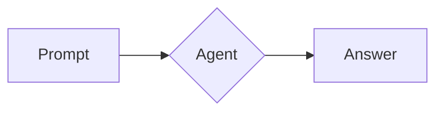

# Markdown gallery

Every Markdown element in one agent message: CommonMark, GitHub Flavored Markdown and common extensions. Each sample starts with a tag (M01 to M36) so a screen dump can be matched to its source.

M01 emphasis: *star italic*, _underscore italic_, **star bold**, __underscore bold__, ***star bold italic***, ___underscore bold italic___, **bold with *nested italic* inside**, *italic with **nested bold** inside*, and intra_word_underscores stay literal.

M02 strikethrough: ~~double tilde~~, ~single tilde~, **~~bold and struck~~** and ~~struck with `code`~~.

M03 inline code: `plain code`, `` code with a ` backtick ``, ``` code with `` two backticks ```, `**not bold**` and `<b>not html</b>`.

M04 links: inline [inline link](https://example.com/inline "Inline title"), reference [reference link][ref], collapsed [ref][], shortcut [ref], autolink <https://example.com/autolink>, email autolink <someone@example.com>, bare URL https://example.com/bare/url and www.example.com/www, and a relative link [README](./README.md).

[ref]: https://example.com/reference "Reference title"

M05 images:  and a reference image ![reference image][ref].

M06 hard line breaks: this line ends with two spaces  
so this one starts on a new row; this one ends with a backslash\
so this one also starts on a new row.
This line follows a plain newline (a soft break), so it joins the line above.

M07 backslash escapes: \*not italic\*, \_not italic\_, \`not code\`, \# not a heading, \[not a link\](x), \~~not struck\~~, \\ one backslash, \| a pipe, \<not html\>.

M08 entities: &amp; &lt; &gt; &quot; &copy; &reg; &trade; &euro; &pound; &frac12; &rarr; &hellip; &#169; &#x1F600; and a non-breaking space between A&nbsp;B.

M09 inline HTML: <kbd>Ctrl</kbd>+<kbd>C</kbd>, <b>b tag</b>, <em>em tag</em>, <span style="color:red">span tag</span>, <sup>sup</sup> and <sub>sub</sub>, <ins>ins tag</ins>, <del>del tag</del>, <mark>mark tag</mark>, a<br>br tag, and a comment <!-- hidden comment --> here.

M10 emoji: shortcodes :smile: :rocket: :+1: :white_check_mark: :warning: and literal 😀 🚀 👍 ✅ ❌ ⚠️ ❤️ 👨‍👩‍👧 🇬🇧 (variation selector, ZWJ sequence and flag).

M11 wide characters: 日本語のテキスト, 中文字符, 한국어, full-width ＡＢＣ１２３, and mixed English 混合 text in one line.

M12 headings, ATX levels 1 to 6, a closed ATX heading and seven hashes:

# Heading level 1

## Heading level 2

### Heading level 3

#### Heading level 4

##### Heading level 5

###### Heading level 6

####### Seven hashes is not a heading

## Closed ATX heading ##

M13 setext headings:

Setext heading level 1
======================

Setext heading level 2
----------------------

M14 thematic breaks, three forms:

---

***

___

M15 unordered lists, nested three levels, then a star list and a plus list:

- Level 1 dash
  - Level 2 dash
    - Level 3 dash
    - Level 3 second
  - Level 2 second
- Level 1 second

A star list:

* Star bullet list
* Star second

A plus list:

+ Plus bullet list
+ Plus second

M16 ordered lists, nested, starting at 7, and with a parenthesis:

1. First
2. Second
   1. Nested first
   2. Nested second
      1. Third level
3. Third

A separate list that starts at seven:

7. Starts at seven
8. Eight
9. Nine
10. Ten (the marker widens)

A list with the parenthesis delimiter:

1) Parenthesis delimiter
2) Parenthesis second

M17 task lists, nested, and ordered:

- [x] Done task
- [ ] Open task
  - [x] Nested done
  - [ ] Nested open
- [X] Capital X done

An ordered task list:

1. [x] Ordered task done
2. [ ] Ordered task open

M18 mixed lists, a loose item and code in an item:

1. Ordered parent
   - Unordered child
   - [ ] Task child
     1. Ordered grandchild
2. Ordered parent with two paragraphs

   The second paragraph inside the item (a loose list).

   ```ts
   const insideList = true;
   ```
3. Third parent

M19 table with alignment (left, centre, right, default) and inline formatting:

| Left | Centre | Right | Default |
| :--- | :---: | ---: | --- |
| a | b | c | d |
| **bold** | *italic* | `code` | ~~struck~~ |
| [link](https://example.com/cell) | 日本語 | 1,234.56 | an \| escaped pipe |

M20 wide table, more than 63 columns:

| Identifier | Customer name | Email address | Created at | Status | Total (GBP) | Notes |
| --- | --- | --- | --- | --- | ---: | --- |
| 1001 | Alice Smith | alice.smith@example.com | 2026-10-04 09:15 | active | 1,234.56 | First order, paid by card |
| 1002 | Bob Jones | bob.jones@example.org | 2026-10-04 10:30 | suspended | 78.90 | Awaiting a reply from the customer about the refund they asked for |

M21 code blocks: php with the opening tag:

```php
<?php

declare(strict_types=1);

final class Greeter
{
    public function greet(string $name): string
    {
        // A comment
        return sprintf('Hello, %s!', $name);
    }
}
```

php without the opening tag:

```php
$total = array_sum(array_map(fn (array $l): float => $l['qty'] * $l['price'], $lines));
echo "Total: {$total}\n";
```

ts:

```ts
interface User { id: number; name: string }

export async function load(id: number): Promise<User> {
  const res = await fetch(`/users/${id}`);
  return (await res.json()) as User;
}
```

json:

```json
{
  "name": "acp-tui",
  "private": true,
  "tags": ["tui", "acp"],
  "count": 3,
  "nothing": null
}
```

bash:

```bash
#!/usr/bin/env bash
set -euo pipefail
for f in *.md; do
  echo "Checking $f" && grep -c '^#' "$f"
done
```

diff:

```diff
--- a/src/Greeter.php
+++ b/src/Greeter.php
@@ -3,3 +3,3 @@
 final class Greeter
-    public function greet($name)
+    public function greet(string $name): string
```

sql:

```sql
SELECT u.id, u.name, COUNT(o.id) AS orders
FROM users u
LEFT JOIN orders o ON o.user_id = u.id
WHERE u.created_at >= '2026-01-01'
GROUP BY u.id, u.name
ORDER BY orders DESC;
```

no language:

```
A fence with no language.
    Indentation inside is kept.
```

a tilde fence (python):

~~~python
# A tilde fence
print("tilde")
~~~

M22 indented code block (four spaces):

    $indented = 'code block';
    echo $indented;

M23 blockquotes, nested three levels, with a list and code:

> Level one quote with **bold** and `code`.
>
> > Level two quote.
> >
> > > Level three quote.
>
> - A list inside the quote
> - Its second item
>
> ```php
> echo 'code in a quote';
> ```

M24 GitHub alerts:

> [!NOTE]
> A note alert.

> [!WARNING]
> A warning alert.

M25 footnotes: a sentence with a numbered footnote[^1] and a named one[^note].

[^1]: The first footnote definition.
[^note]: A named footnote, with **bold** text.

M26 maths: inline dollars $E = mc^2$ and $\alpha + \beta \leq \sqrt{x^2 + y^2}$, inline parentheses \(a^2 + b^2 = c^2\), and prices $5 and $10 that are not maths.

$$
\sum_{i=1}^{n} i = \frac{n(n+1)}{2}
$$

\[
\int_0^\infty e^{-x^2}\,dx = \frac{\sqrt{\pi}}{2}
\]

M27 HTML blocks:

<details>
<summary>Click to expand</summary>

Hidden content with **Markdown** inside.

</details>

<div align="center">
  <strong>A centred HTML block</strong>
</div>

<!-- An HTML comment block that should not be shown -->

M28 definition list (not GFM):

Term one
: The definition of term one.

Term two
: First definition of term two.
: Second definition of term two.

M29 other extensions: ==highlighted==, H~2~O subscript, x^2^ superscript, ++inserted++, an abbreviation HTML, and a mermaid fence:

*[HTML]: Hyper Text Markup Language



M30 a very long word and a very long URL:

Supercalifragilisticexpialidociousantidisestablishmentarianismpneumonoultramicroscopicsilicovolcanoconiosis is one word.

https://example.com/a/very/long/path/that/keeps/going/and/going/well/past/the/width/of/the/terminal/pane?query=string&with=parameters#and-a-fragment

M31 links with unsafe schemes (none may be opened from agent text): [script link](javascript:alert(1)), [data link](data:text/html;base64,PHNjcmlwdD5hbGVydCgxKTwvc2NyaXB0Pg==), [absolute file link](file:///etc/passwd) and [mixed-case scheme](JavaScript:alert(2)).

M32 a deceptive label, where the label looks like one site and the target is another: [https://bank.example](https://evil.example/login) and a safe one for comparison: [https://example.com/same](https://example.com/same).

M33 relative links, one inside the working directory and two outside it: [inside the working directory](src/index.ts), [outside the working directory](../../outside/secret.txt) and [absolute path](/etc/hosts).

M34 GitHub alerts, all five kinds:

> [!NOTE]
> Useful information that users should know, with `code` and a [link](https://example.com/note).

> [!TIP]
> Helpful advice for doing things better.

> [!IMPORTANT]
> Key information users need to know.

> [!WARNING]
> Urgent info that needs immediate attention.

> [!CAUTION]
> Advises about risks or negative outcomes.

M35 HTML links: an <a href="https://example.com/html-link">anchor tag</a> in a sentence, and an <a href="javascript:alert(3)">anchor with an unsafe target</a>.

M36 a details block with a summary and a list inside:

<details>
<summary>Show the <b>build</b> steps</summary>

1. Install the dependencies.
2. Run the tests.

</details>

M99 end of gallery.
